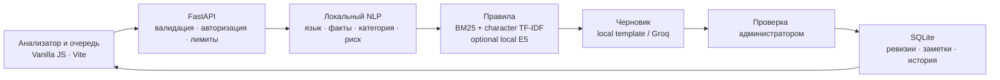

# Grand Mobile Support Copilot

**Поддержка игроков на трёх языках. Решения — под контролем администратора.**

Grand Mobile Support Copilot собирает обращение, факты, правила и черновик ответа в одном рабочем месте. Администратор получает понятный разбор ситуации, видит основания ответа и сохраняет своё решение с историей изменений.

**BizAI · Decentrathon 6.0 · кейс Grand Mobile**

[Конкурсный отчёт](docs/SUBMISSION.md) · [Результаты проверки](docs/DEADLINE_VERIFICATION.md) · [Архитектура NLP](docs/NLP_GUIDE.md) · [Запуск и эксплуатация](docs/DEPLOYMENT.md)

## От обращения до решения

В поддержке важен весь путь обращения: понять игрока, определить срочность, найти основание, сформулировать ответ и сохранить результат. Copilot связывает эти действия в один сценарий.

1. **Принять обращение.** Текст, тип, язык сервера, идентификатор игрока и количество вложений.
2. **Разобрать ситуацию.** Язык сообщения, категория, приоритет, извлечённые сведения, признаки спама и повтора.
3. **Сопоставить основания.** Исходный и нормализованный текст, разделы правил, номера пунктов и причины проверки человеком.
4. **Подготовить ответ.** Черновик на языке игрока, редактирование, копирование и переход к сохранённому обращению.
5. **Завершить проверку.** Сохранение правок и заметки, эскалация, история решений и подтверждаемая симуляция отправки.

## Сильные стороны решения

| Возможность | Практическая ценность |
|---|---|
| **Единое рабочее место** | Исходное обращение, сведения, источники и ответ доступны для сравнения. Очередь поддерживает поиск, фильтры и приоритеты. |
| **Русский, казахский, узбекский** | Локальная нормализация, обработка алфавитов и апострофов, определение языка сообщения и языковые шаблоны. |
| **Контроль риска** | Платежи, апелляции и подозрения на взлом проверяются независимо от модельной категории. Неизвестный off-topic требует уточнения человеком. |
| **Прослеживаемые источники** | Локальный корпус правил, внутренние идентификаторы «раздел + пункт», публичные ссылки и полный текст источника в интерфейсе. |
| **Сохранность работы администратора** | Идемпотентное создание, ревизии, свежие серверные данные при конфликте 409, восстановление несохранённого текста и заметки. |
| **Работа без внешней LLM** | Локальный анализ и шаблоны доступны без API-ключа. При включении Groq режим генерации и fallback различаются явно. |
| **Воспроизводимая инженерная основа** | Совместимые HTTP/JSONL-контракты, автоматические тесты, инструкции запуска и отдельный протокол измерений. |

Интерфейс построен вокруг чтения и сравнения: кириллическая типографика IBM Plex Sans, устойчивые области исходного текста и ответа, заметные состояния сохранения и ошибок, адаптация для телефона и работа с клавиатуры. Шрифт поставляется локально.

## Подтверждённые результаты

Последняя общая проверка кода выполнена 31 октября 2026 года. Полная методика и ограничения — в [отчёте проверки](docs/DEADLINE_VERIFICATION.md).

| Проверка | Результат | Условия |
|---|---:|---|
| Backend и Python-скрипты | **402 passed**, 2 skipped | Windows, Python 3.12; два пропуска связаны с правами на создание symlink |
| Frontend | **34 теста прошли** | Vitest; TypeScript и Vite build также прошли |
| HTTP-создание обращения | **12/12 успешных запросов** | Реальный FastAPI + SQLite, синтетические ru/kk/uz обращения |
| Полный HTTP-ответ | **p50 14,11 мс · p95 17,49 мс** | N=12, concurrency=1, прогретый сервер, локальные шаблоны, без dense-модели |
| Пакетный контракт | **1000/1000 обработано** | Настоящий valid, реальные rules.json и taxonomy.json, без внешних API |
| POST /triage | **HTTP 200** | Синтетическое платёжное обращение направлено человеку |
| Расходы внешнего API в этом прогоне | **$0** | Локальный режим; стоимость компьютера не измерялась |

Это измерения работоспособности и задержки. Небольшой синтетический HTTP-прогон не доказывает production SLO; доля эскалаций и количество тестов не являются точностью классификации. На valid человек требуется в **988 из 1000** случаев — показатель опубликован без искусственного снижения.

## Архитектура



- **Frontend:** vanilla HTML/CSS/JavaScript + Vite; анализатор и очередь используют настоящий API.
- **Backend:** один FastAPI-сервис и SQLite, без обязательной облачной инфраструктуры.
- **Классификация:** локальные эвристики и optional LogisticRegression на хэшированных n-граммах. E5 используется как дополнительный локальный encoder и сравнение с прототипами.
- **Правила:** поиск по разрешённому rules.json; тренировочные обращения и готовые ответы администраторов не индексируются как база ответов.
- **Генерация:** безопасные локальные фразы; optional Groq `openai/gpt-oss-20b` или `openai/gpt-oss-120b` выбирает структурированный план их композиции. Схема, допустимые ссылки и план проверяются кодом.
- **Хранение:** короткие транзакции, история правок, `expected_revision`, идемпотентность и признаки повторных обращений.

Контракты: `POST /triage`, `POST /api/tickets`, `PATCH /api/tickets/{id}/review`, пакетный `make predict`. Подробности — в [backend README](backend/README.md).

## Короткие ответы на языке игрока

Ниже — фактические локальные шаблоны, полученные через HTTP на синтетических платёжных примерах. Во всех трёх случаях определён нужный язык, категория `report.payment`, `needs_human=true`; цитаты отсутствуют.

**RU:** «Приветствую! Вопрос оплаты проверит специалист. Укажите дату, сумму и способ оплаты; номер карты, пароли и коды не присылайте.»

**KK:** «Сәлеметсіз бе! Төлем мәселесін маман тексереді. Төлем күнін, сомасын және тәсілін көрсетіңіз; карта нөмірін, құпиясөз бен кодтарды жібермеңіз.»

**UZ:** «Salom! To‘lov masalasini mutaxassis tekshiradi. To‘lov sanasi, summasi va usulini ko‘rsating; karta raqami, parol va kodlarni yubormang.»

Эти примеры подтверждают поведение конкретных сценариев; оценка естественности носителями языка остаётся отдельной задачей.

## Быстрый запуск

Требуются **Python 3.12+** и **Node.js 22.12+**. Команды выполняются из корня репозитория.

### Windows / PowerShell

```powershell
py -3.12 -m venv .venv
.venv/Scripts/python.exe -m pip install -c constraints.txt -r backend/requirements-dev.txt
npm --prefix frontend ci
npm run build
npm start
```

### Linux / macOS

```bash
make setup
make build
make serve
```

Откройте **http://127.0.0.1:8000**. По умолчанию доступны синтетические правила и локальные шаблоны. Для работы с настоящим корпусом настройте игнорируемый `.env` по [.env.example](.env.example): `RULES_PATH`, `TAXONOMY_PATH`, приватный `DATABASE_PATH`. Режим `APP_MODE=production` требует `API_TOKEN` длиной минимум 24 символа и настоящий корпус правил.

Для Windows используйте абсолютный приватный путь к SQLite или оставьте `DATABASE_PATH` пустым для системного временного каталога. Для сохранности очереди между очистками временных файлов нужен постоянный приватный каталог.

Ключ Groq хранится только на сервере; токен подключения интерфейса — отдельный `API_TOKEN`. Обучение для запуска не требуется. Для inference без автоматического обучения оставьте `TRAIN_PATH` пустым.

Проверки после установки зависимостей: `npm test`. Браузерный E2E: установите корневые зависимости через `npm ci`, подготовьте Chromium/Edge и выполните `npm run test:e2e`. [Инструкция frontend](frontend/README.md) · [Docker и эксплуатация](docs/DEPLOYMENT.md).

## Данные и границы проверки

Корпус организаторов содержит **118 337 train** и **1000 valid**. Данные, правила, производные выборки, SQLite и веса остаются вне Git, образов и CI artifacts. В завершающем прогоне valid использовался только для предсказаний; обучение не запускалось. Ответы администраторов и итоговые поля исключаются из входа inference.

Существование цитаты проверяемо, но применимость части правил, выбранных напрямую по taxonomy, ещё требует доработки. Результаты команды на 198 размеченных обращениях сохранены в [METRICS.md](docs/METRICS.md) как исторические: после изменения inference они не воспроизведены на тех же приватных моделях и gold. Новые accuracy и macro-F1 не заявляются.

Свежий прогон использовал локальные шаблоны. Предыдущие live Groq, Docker и браузерные проверки сохранены отдельно; они не выдаются за повторную проверку последнего кода. У приложения пока общий административный токен, без персонального SSO/RBAC.

**Все решения остаются у администратора.** Подключения к игровым серверам нет: отправка явно симулируется. Сервис не исполняет наказания, возвраты или разблокировку и не утверждает, что просмотрел недоступные изображения.

## Документация

[Конкурсный отчёт](docs/SUBMISSION.md) · [Актуальная проверка](docs/DEADLINE_VERIFICATION.md) · [Метрики и происхождение данных](docs/METRICS.md) · [NLP](docs/NLP_GUIDE.md) · [Разметка](docs/LABELING.md) · [API и конкурентные изменения](docs/BACKEND_OPERATIONS.md) · [Безопасность](SECURITY.md) · [Лицензии компонентов](THIRD_PARTY_NOTICES.md)
