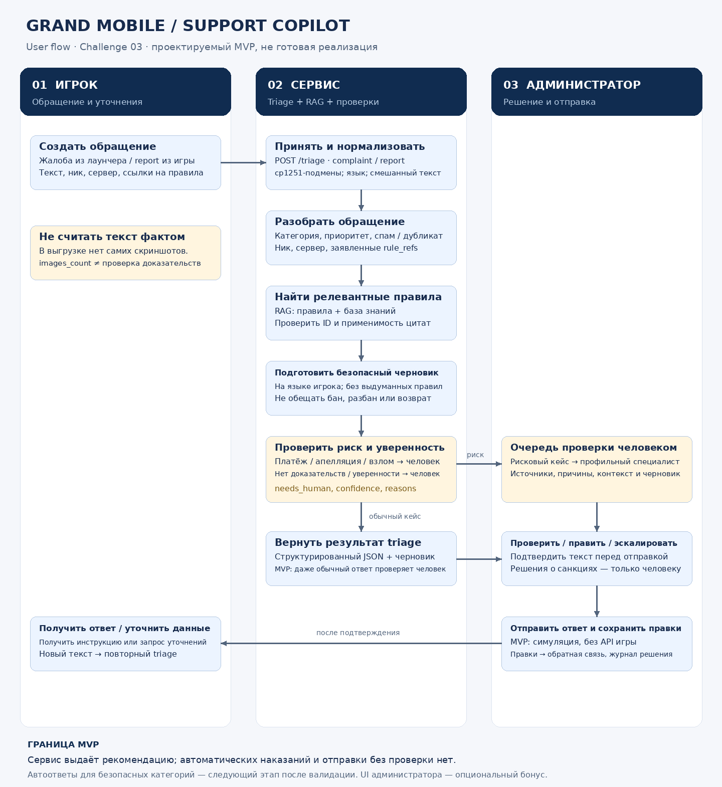

# Grand Mobile · Support Copilot

**BizAI · Decentrathon 6.0 · кейс 03.** Автономный HTTP-сервис триажа и интерфейс администратора: обращение → поиск правил → безопасный черновик → проверка человеком.

> По умолчанию запускается **синтетическая демонстрация без API-ключей**. Учебные тексты не являются правилами Grand Mobile. Отправка ответа симулируется; сервис не подключён к игре, не выдаёт наказания, не разблокирует аккаунты и не возвращает деньги.

## Что реализовано

- `POST /triage` и пакетный `make predict` с проверяемым JSON-контрактом.
- Локальный baseline языка, категории, приоритета, заявленных фактов, спама и дубликатов; нормализация казахских cp1251-подмен. При подключённом E5 — дополнительное сравнение с синтетическими прототипами категорий.
- RAG: BM25 + символьный TF-IDF, при желании локальные multilingual-E5 embeddings. Внутренние ID правил сохраняют `раздел:пункт`; публичное поле `draft_reply.cited` содержит `points[].ref`, а текст ответа и карточка источника сохраняют контекст раздела.
- Локальные безопасные шаблоны на `ru`, `kk`, `uz`, `en`, `es`, `pt`; отдельный выключенный по умолчанию адаптер генерации Groq.
- Очередь, фильтры, карточка обращения, контекст, источники, редактирование, подтверждение симулированной отправки, эскалация и история правок в SQLite.
- Ограничения входа, серверная валидация, токен API, проверка конкурентных изменений и идемпотентность создания обращения.
- Флуд по идентификатору игрока: шестое и последующие обращения за час помечаются и направляются человеку; они не отклоняются и не ведут к автоматическим санкциям.

Интерфейс — обычные **HTML, CSS и JavaScript**, сборка через Vite, без React-runtime. Раздел «Анализ» создаёт обращение через `POST /api/tickets`; «Очередь админа» использует тот же backend для проверки, правок, эскалации и симуляции отправки. Типографика IBM Plex Sans поставляется локально, без внешнего font CDN.

**Это не дообученная на корпусе нейросеть и не заявление о production-ready качестве.** Без модели классификация и поиск лексические; optional E5 — реальный pretrained encoder для retrieval и сходства с прототипами, не fine-tuned classifier. Confidence — эвристический сигнал, не калиброванная вероятность. Веса локальной модели не включены. Качество казахского/узбекского требует проверки носителями. Платежи, апелляции и взлом направляются человеку; в этом MVP все черновики проверяет администратор.

## Быстрый запуск

### Docker Compose

Нужен Docker с Compose v2.

```bash
git clone https://github.com/BAITC-Hacks/hack-f5edd1aa-bizai.git
cd hack-f5edd1aa-bizai
docker compose up --build -d
```

Откройте **http://127.0.0.1:8000**. Контейнер доступен только с локального компьютера, работает не от root, с read-only корневой файловой системой. Изменения очереди сохраняются в Docker volume `copilot-runtime`. `docker compose down` останавливает приложение, но не удаляет этот volume.

### Без Docker

Нужны **Python 3.12**, **Node.js 22.12+** и `make` (Linux/macOS или WSL).

```bash
make setup
make dev
```

UI: **http://127.0.0.1:5173**; API: **http://127.0.0.1:8000**. `Ctrl+C` останавливает оба процесса. Для сборки и одного порта:

```bash
make build
make serve
```

С новой API-базой очередь начинает работу пустой. Создайте тестовое обращение в разделе «Анализ» или добавьте явно отмеченные синтетические примеры; оно появится в «Очереди админа» (`/#queue`). База по умолчанию находится **вне репозитория**, `/tmp/grandmobile/copilot.sqlite3`: для долговременного локального хранения задайте собственный приватный `DATABASE_PATH`.

При недоступном API или с `?demo=1` включается явно обозначенное браузерное демо: синтетические правила, эвристики и очередь только в памяти вкладки. Этот режим не записывает обращения в SQLite и не заменяет проверку серверного конвейера. Подключённый API, требующий токен, не подменяется демо из-за ошибки авторизации.

## API и пакетный запуск

Минимальный синтетический пример, не взятый из датасета:

```bash
curl --fail http://127.0.0.1:8000/triage \
  -H 'Content-Type: application/json' \
  -d '{"kind":"report","messages":[{"role":"player","text":"Не могу выйти из текстур. Нужна помощь."}]}'
```

Если задан `API_TOKEN`, добавьте `Authorization: Bearer <ваш токен>`; UI принимает **токен приложения**, не ключ Groq. Токен UI хранится только в памяти вкладки. `/health` и `/ready` предназначены для проверок доступности, а не для получения содержимого очереди.

```bash
# Все входы, результаты и отчёты — вне checkout.
RULES_PATH=/secure/grandmobile/rules.json make predict IN=/secure/grandmobile/tickets_valid.jsonl OUT=/secure/results/pred.jsonl
RULES_PATH=/secure/grandmobile/rules.json make evaluate IN=/secure/grandmobile/tickets_valid.jsonl OUT=/secure/results/report.json
```

Для пакетного запуска нужен разрешённый `RULES_PATH`: без него CLI завершится с ошибкой, а не подставит демо-правила. Только для отдельного синтетического теста доступен явный CLI-флаг `--allow-synthetic-rules`. В строке `pred.jsonl` перед результатом триажа сохраняется входной `ticket_id`, если он передан; HTTP `/triage` сохраняет собственный контракт ответа без этого служебного поля.

CLI отделяет вход обращения от исторического ответа администратора и outcome-полей. `evaluate` формирует операционные агрегаты (доли, latency, существование ID цитат), **не** category accuracy или priority macro-F1: эти поля остаются `null`. Для оценки качества нужен отдельный gold-набор и проверка экспертами; отсутствие меток не заменяется нулём или выдуманной оценкой. Данные validation нельзя использовать как правила или переносить в публичные примеры. Самопроверка на синтетических кейсах не доказывает качество на скрытом тесте.

## Настройки, правила и модели

`cp .env.example .env` — необязательный шаг. Все секреты в примере пустые. Локальные `make`-команды читают `.env` без выполнения shell-команд; уже установленные переменные среды имеют приоритет. Compose использует собственные правила `.env`-интерполяции. Не запускайте команды, печатающие полностью раскрытую конфигурацию с ключами.

| Переменная | Назначение |
|---|---|
| `APP_MODE` | `demo` по умолчанию; `production` требует токен и приватный корпус правил |
| `RULES_PATH`, `TAXONOMY_PATH` | Абсолютные пути к разрешённым приватным файлам; никогда не копируются в образ |
| `DATABASE_PATH` | Приватная SQLite-база; история обращений и правок не является публичным артефактом |
| `API_TOKEN` | Bearer-токен администратора; в production минимум 24 символа |
| `FLOOD_LIMIT_PER_HOUR` | Допустимые обращения одного игрока за час: по умолчанию 5, диапазон 1–1000; превышение — сигнал человеку, не HTTP-отказ |
| `ENABLE_GROQ`, `GROQ_API_KEY` | Внешняя генерация: `false` и пустой ключ по умолчанию |
| `ALLOW_PRIVATE_DATA_TO_GROQ` | Отдельное явное разрешение передать приватные тексты/правила провайдеру; по умолчанию `false` |
| `GROQ_MODEL` | По умолчанию `openai/gpt-oss-20b`; strict-schema адаптер также поддерживает `openai/gpt-oss-120b` |
| `GROQ_*_USD_PER_MILLION` | Ваши реальные ставки; пустое значение означает неизвестную стоимость, не бесплатность |
| `LOCAL_ENCODER_PATH` | Каталог уже скачанной E5-совместимой модели; автоматических загрузок нет |
| `LOCAL_MODEL_THREADS` | CPU-потоки local encoder: по умолчанию 2, допустимо 1–16 |

### Проверенный локальный encoder E5 (опционально)

Для [multilingual-e5-small, MIT](https://huggingface.co/intfloat/multilingual-e5-small) предусмотрен отдельный явный setup: фиксированные файлы `safetensors`, tokenizer/config и model card, около **493 MB** без Python-библиотек. Revision: `614241f622f53c4eeff9890bdc4f31cfecc418b3`. Runtime никогда сам не скачивает модель.

Следующая комбинация optional-зависимостей проверена на **Python 3.12 / Linux x86_64**. На macOS/другой архитектуре подберите официальный совместимый PyTorch wheel и заново проверьте окружение; суффикс `+cpu` не универсален для всех платформ.

```bash
# Каталоги вне любого Git checkout; используйте доступные вам приватные пути.
python3 -m venv /secure/venvs/copilot-e5
/secure/venvs/copilot-e5/bin/pip install --index-url https://download.pytorch.org/whl/cpu 'torch==2.9.1+cpu'
/secure/venvs/copilot-e5/bin/pip install -c constraints.txt -c constraints-models.txt \
  -r backend/requirements-models.txt 'sentence-transformers==5.7.0' 'transformers==4.57.6' 'sentencepiece==0.2.2'
python3 scripts/fetch_local_encoder.py --destination /secure/models/multilingual-e5-small --download
python3 scripts/fetch_local_encoder.py --destination /secure/models/multilingual-e5-small --verify-only
make build
LOCAL_ENCODER_PATH=/secure/models/multilingual-e5-small \
  HF_HUB_OFFLINE=1 TRANSFORMERS_OFFLINE=1 HF_HUB_DISABLE_TELEMETRY=1 \
  LOCAL_MODEL_THREADS=2 OMP_NUM_THREADS=2 MKL_NUM_THREADS=2 \
  make serve PYTHON=/secure/venvs/copilot-e5/bin/python
```

Helper проверяет SHA-256 и размер каждого файла, отказывается писать веса внутрь Git и не принимает remote-code или pickle weights. `--verify-only` работает без сети. SHA-256 `model.safetensors`: `1a55775f53449dac10a2bcbc312469fac40b96d53198c407081a831f81c98477`.

Фактические загрузка и CPU embeddings проверены с этой версией; это **не** оценка качества retrieval на размеченном корпусе. `LOCAL_ENCODER_PATH` должен оставаться вне репозитория. Модель загружается CPU-only с `local_files_only=True` и `trust_remote_code=False`. Длинный текст encoder обрезает до своего контекстного лимита (512 токенов у этого snapshot). Инициализация модели и индексов занимает дополнительное время; `/ready` не становится доступен до завершения startup. Batch latency не включает этот холодный запуск. Стандартный Docker-образ содержит только lexical baseline; для encoder нужен отдельно проверенный образ с optional dependencies и read-only mount модели. Веса и Python-окружение не коммитятся.

### Ограниченная генерация Groq

Адаптер использует [GPT-OSS 20B](https://console.groq.com/docs/model/openai/gpt-oss-20b) по умолчанию; также поддерживается `openai/gpt-oss-120b`. Для обеих моделей Groq документирует [strict JSON Schema](https://console.groq.com/docs/structured-outputs). Старый Llama default заменён в соответствии с [историей отключений моделей](https://console.groq.com/docs/deprecations). Другие model IDs требуют отдельной проверки адаптера и отклоняются до сетевого вызова.

Модель возвращает **только компактный план порядка готовых фраз и список разрешённых цитат**. Проверенный код локально собирает ответ; модель не может дописать произвольную фразу, обещание или правило. Это не свободная генерация ответа. Strict-schema соответствие не доказывает релевантность правил или качество языка; человеческая проверка сохраняется.

Перед включением Groq проверьте доступность модели именно вашему аккаунту, лимиты, ставки и разрешение на обработку данных. Документация провайдера и mocked tests не доказывают успешный live-вызов. Ключ задаётся только на сервере. При таймауте, ошибке, недопустимом плане/цитате или рискованной теме используется локальный шаблон; такой fallback не считается успешной генерацией Groq. `make check`, обычный demo и batch CLI не выполняют платных live-вызовов.

## Проверка

```bash
make check
```

Команда запускает backend/root unit tests, frontend tests, TypeScript, production UI build и проверку candidate-файлов на явные секреты/датасеты. GitHub Actions дополнительно собирает контейнер и проверяет `/ready` и UI. Эти проверки не используют API-ключи, реальные обращения или внешнюю LLM. Наличие workflow не означает, что конкретный commit уже прошёл CI: проверяйте статус соответствующего запуска.

### Отдельная синтетическая проверка Groq

```bash
# Обе команды офлайн: первая показывает план, вторая использует MockTransport.
# Они не читают ключ даже при наличии GROQ_API_KEY или --env-file.
.venv/bin/python scripts/validate_groq_synthetic.py
.venv/bin/python scripts/validate_groq_synthetic.py --mode mock
```

Harness проверяет только фиксированные синтетические вопросы на шести языках без правил и датасетов. Mock-результаты не являются измерением провайдера. Live-режим включается отдельно, только после разрешения владельца ключа, проверки текущих цен и доступности сети:

```bash
# GROQ_API_KEY уже должен быть передан локальным менеджером секретов в environment.
.venv/bin/python scripts/validate_groq_synthetic.py --mode live \
  --ledger /secure/grandmobile/groq-validation-ledger.json \
  --output /secure/grandmobile/groq-smoke.json \
  --budget-usd 1 --acknowledge-paid-synthetic-data --pricing-reviewed-on 2026-10-30
```

Ключ передаётся только локально. Optional `--env-file` принимает приватный файл с правами `0600` вне Git; его реальный путь и содержимое не публикуются. Ledger и отчёт также находятся вне любого checkout. Harness блокирует параллельное использование одного ledger, резервирует полную верхнюю оценку контекста **до каждой попытки**, включая retry, и не возвращает резерв при ошибке. Лимит — не больше $1 при проверенных в коде on-demand ставках, до 48 completion attempts и двух model probes. **Не удаляйте и не заменяйте ledger для повторного запуска в рамках того же разрешения.** Это не account-wide лимит: другие процессы и изменения тарифов им не контролируются.

Отчёт различает принятый provider plan, локальный fallback и неизвестную стоимость. Таймаут, DNS/egress-блокировка, HTTP-ошибка или mock не подтверждают работоспособность live API. Измеренная здесь latency относится только к адаптеру генерации, не ко всему HTTP/RAG pipeline; качество языка, category accuracy и production p95 таким smoke-тестом не доказываются. Секреты, provider bodies, тексты запросов и черновики в отчёт не записываются.

Проверка 2026-10-30: offline/mock-проверки выполнены; **live completion calls: 0**. Доступ к провайдеру из среды проверки заблокирован на сетевом уровне. Работоспособность ключа и доступность моделей этому аккаунту не установлены; реальный provider latency/usage не измерен.

Стоимость вызовов провайдера в локальном режиме — **0 вызовов**, но CPU, хранение и хостинг не бесплатны. Бюджет $0.002/обращение и p95 ≤5 секунд — требования кейса, а не заявленный результат этого репозитория. Итоговый отчёт нужно получать на разрешённой валидации и целевом оборудовании; стоимость не известна без ставок/usage.

## Конфиденциальность и развёртывание

**Ни датасеты, ни производные выборки не должны попадать в Git, Docker context, CI artifacts или публичную демонстрацию.** Ограничения кейса действуют и для приватного GitHub-репозитория. Удалите данные в течение 14 дней после объявления победителей, если нет отдельного соглашения с Grand Mobile.

- [Настройка закрытого развёртывания и приватных mounts](docs/DEPLOYMENT.md)
- [Безопасность и границы MVP](SECURITY.md)
- [Источники и сторонние лицензии](THIRD_PARTY_NOTICES.md)

В репозитории нет ключей, действующих правил, весов модели или реальных обращений. `.gitignore`, `.dockerignore` и release-check — защита от случайной ошибки, не замена ручной проверки diff.

## Исходная схема процесса

Ранее подготовленные схемы сохранены без изменений как проектная история: [SVG](docs/user-flow.svg) · [PNG](docs/user-flow.png) · [Mermaid](docs/user-flow.mmd). Надпись «не готовая реализация» в исходном рисунке относится к этапу проектирования; текущее поведение и ограничения описаны выше.


