# Актуальный flow — Grand Mobile Support Copilot

Сверено с кодом main `0a9383daa460beb9fef5cb6d625475dc6c286111`, 31 октября 2026. Схема описывает реализованный MVP, не интеграцию с игровым сервером.

```mermaid
flowchart TB
  subgraph INPUT["1 · Вход и защита"]
    A["Обращение игрока: report / complaint"]
    UI["Рабочее место администратора"]
    API["POST /triage или POST /api/tickets"]
    AUTH["Проверка схемы, размера, Origin и rate limit<br/>Bearer token — если настроен"]
    IDEM["Idempotency-Key / ticket_id<br/>Повтор запроса возвращает существующий ticket"]
    A --> API
    UI --> API
    API --> AUTH --> IDEM
  end
  subgraph LOCAL["2 · Локальная обработка"]
    NLP["Только сообщения player<br/>Нормализация, язык, извлечение ника / правил / сервера<br/>Количество вложений — НЕ анализ изображений"]
    CLS["Категория и приоритет<br/>Лексические правила + опциональные trained models / E5 prototypes"]
    RISK["Независимые safety-сигналы<br/>Жалобы, чувствительные темы, injection,<br/>неясный язык / низкая уверенность → human review"]
    RAG["Локальный RAG по правилам<br/>BM25 + char TF-IDF; опционально E5<br/>Подбор цитат; проверяет человек"]
    POLICY[("Файл правил + taxonomy<br/>Synthetic demo или real private corpus")]
    NLP --> CLS --> RISK --> RAG
    POLICY --> RAG
  end
  IDEM --> NLP
  subgraph DRAFT["3 · Безопасный черновик"]
    GATE{"Groq включён и разрешён?<br/>Нет injection, sensitive case<br/>или synthetic citations"}
    LLM["Опциональный Groq<br/>Редактированные данные + approved clauses<br/>Только JSON-план порядка фраз и citation IDs"]
    CHECK["Проверка ответа / плана<br/>Текст собирается локально из разрешённых фраз"]
    TEMPLATE["Детерминированный локальный шаблон"]
    DRAFTED["Черновик на языке ответа<br/>Неизвестный язык → язык сервера / русский"]
    RAG --> GATE
    GATE -->|Да| LLM --> CHECK
    GATE -->|Нет| TEMPLATE
    CHECK -->|Валиден| DRAFTED
    CHECK -->|Невалиден| TEMPLATE
    LLM -->|Ошибка / timeout| TEMPLATE
    TEMPLATE --> DRAFTED
  end
  subgraph REVIEW["4 · Очередь и решение человека"]
    DUP["Дубли / flood за час / spam<br/>Флаги очереди, не удаление и не наказание"]
    DB[("SQLite transaction<br/>tickets + idempotency + dedup")]
    JSON["JSON: category, priority, citations,<br/>draft_reply, needs_human, reasons, diagnostics"]
    QUEUE["Очередь: фильтры, поиск, карточка<br/>Проверить правила и черновик"]
    EDIT["Правка / эскалация / подтверждение<br/>PATCH review + expected_revision"]
    FEEDBACK[("SQLite feedback + revision<br/>Конфликт → 409; перечитать карточку")]
    SEND["simulated_sent<br/>Только симуляция отправки"]
    DRAFTED --> DUP --> DB --> JSON --> QUEUE --> EDIT
    EDIT --> FEEDBACK
    EDIT --> SEND
  end
  UI --> QUEUE

  classDef blue fill:#e8f0ff,stroke:#4169b1,color:#142947;
  classDef green fill:#e6f4ed,stroke:#328164,color:#14382b;
  classDef amber fill:#fff3da,stroke:#bd8220,color:#573d15;
  classDef purple fill:#f0eaff,stroke:#8060b0,color:#33224e;
  class API,AUTH,IDEM,NLP,CLS,RAG blue;
  class DRAFTED,CHECK,TEMPLATE green;
  class RISK,GATE,DUP,SEND amber;
  class DB,POLICY,FEEDBACK,LLM purple;
```

[Актуальная схема PNG](current-flow.png) · [SVG](current-flow.svg)

## Важные границы реализации

- **Применимость прямых taxonomy-selected цитат проверяется не полностью.** Схема показывает подбор источников, не гарантирует релевантность каждой цитаты; финальная проверка остаётся у администратора.

- **Нет реальной отправки в игру.** `simulated_sent` — сохранённый статус; игрового delivery API в этом потоке нет.
- **LLM не пишет произвольный ответ:** Groq возвращает план композиции, приложение локально собирает разрешённые фразы. Ошибка, timeout или невалидный ответ ведут к безопасному шаблону.
- **Private corpus не отправляется наружу без отдельного разрешения** `allow_private_data_to_groq`. Чувствительные темы используют шаблон, даже если Groq включён.
- **Human review:** все жалобы, чувствительные случаи, synthetic rules, недостаточные основания и включённый Groq требуют проверки. `needs_human=false` не означает автоматическую отправку.
- **Нет доказательства нарушения по числу вложений:** изображения не просматриваются. Нет автоматических санкций, разбана или возврата.
- **Модели опциональны:** trained classifiers и локальный E5 работают только при загрузке артефактов. Наличие конфигурации не доказывает качество; confidence baseline не откалиброван.
- Есть in-memory cache черновиков/цитат и диагностика latency / provider usage. Это не отдельная внешняя БД.
- Правки администратора сохраняются как feedback, **не становятся автоматически правильными обучающими метками**.

## Проверено по исходникам

| Участок | Исходник |
|---|---|
| HTTP, auth, rate limits, API очереди и review | [main.py](../backend/app/main.py) |
| Порядок pipeline, safety routing, cache, idempotency | [service.py](../backend/app/service.py) |
| Нормализация, язык, признаки, чувствительные темы | [nlp.py](../backend/app/nlp.py) |
| Локальный hybrid retrieval и цитаты | [retrieval.py](../backend/app/retrieval.py) |
| Groq composition plan, проверка и fallback | [generation.py](../backend/app/generation.py) |
| SQLite, dedup, revisions, feedback | [storage.py](../backend/app/storage.py) |

Предыдущие графические материалы: [SVG](user-flow.svg), [PNG](user-flow.png), [Mermaid](user-flow.mmd). Они сохранены без изменений; актуальная кодово-проверенная схема находится выше.

